<picture><source media="(prefers-color-scheme: dark)" srcset="assets/header-dark.svg"></picture>

 

### projects

<a href="https://github.com/qwelpl/barloom"><picture><source media="(prefers-color-scheme: dark)" srcset="assets/barloom-dark.svg"></picture></a>&nbsp;<a href="https://github.com/qwelpl/peacemusic"><picture><source media="(prefers-color-scheme: dark)" srcset="assets/peace-dark.svg"></picture></a>

<a href="https://stem-nb.vercel.app"><picture><source media="(prefers-color-scheme: dark)" srcset="assets/quovine-dark.svg"></picture></a>&nbsp;<a href="https://github.com/qwelpl/wildfire"><picture><source media="(prefers-color-scheme: dark)" srcset="assets/wildfire-dark.svg"></picture></a>

<a href="https://tiledrop.vercel.app"><picture><source media="(prefers-color-scheme: dark)" srcset="assets/tiledrop-dark.svg"></picture></a>&nbsp;<a href="https://github.com/qwelpl/mirror-repo"><picture><source media="(prefers-color-scheme: dark)" srcset="assets/mirror-repo-dark.svg"></picture></a>

 

### activity

<picture><source media="(prefers-color-scheme: dark)" srcset="assets/stats-dark.svg"></picture>

<picture><source media="(prefers-color-scheme: dark)" srcset="assets/langs-dark.svg"></picture>

 

### stack

