<picture><source media="(prefers-color-scheme: dark)" srcset="assets/header-dark.svg"></picture>

<a href="https://tile-drop.com/q_welpl"><picture><source media="(prefers-color-scheme: dark)" srcset="assets/link-site-dark.svg"></picture></a>&nbsp;
<a href="mailto:aaravgulrajani19@gmail.com"><picture><source media="(prefers-color-scheme: dark)" srcset="assets/link-email-dark.svg"></picture></a>&nbsp;
<a href="https://www.instagram.com/aarav.gulrajani/"><picture><source media="(prefers-color-scheme: dark)" srcset="assets/link-instagram-dark.svg"></picture></a>

 

### projects

<a href="https://github.com/qwelpl/barloom"><picture><source media="(prefers-color-scheme: dark)" srcset="assets/barloom-dark.svg"></picture></a>&nbsp;<a href="https://github.com/qwelpl/peacemusic"><picture><source media="(prefers-color-scheme: dark)" srcset="assets/peace-dark.svg"></picture></a>

<a href="https://stem-nb.vercel.app"><picture><source media="(prefers-color-scheme: dark)" srcset="assets/quovine-dark.svg"></picture></a>&nbsp;<a href="https://github.com/qwelpl/wildfire"><picture><source media="(prefers-color-scheme: dark)" srcset="assets/wildfire-dark.svg"></picture></a>

<a href="https://tiledrop.vercel.app"><picture><source media="(prefers-color-scheme: dark)" srcset="assets/tiledrop-dark.svg"></picture></a>&nbsp;<a href="https://github.com/qwelpl/mirror-repo"><picture><source media="(prefers-color-scheme: dark)" srcset="assets/mirror-repo-dark.svg"></picture></a>

 

### contributed to

<a href="https://github.com/talkvalue/Buddi/pulls?q=is%3Apr+author%3Aqwelpl"><picture><source media="(prefers-color-scheme: dark)" srcset="assets/contrib-talkvalue-buddi-dark.svg"></picture></a>&nbsp;<a href="https://github.com/Ashwagandhae/debate-flow/pulls?q=is%3Apr+author%3Aqwelpl"><picture><source media="(prefers-color-scheme: dark)" srcset="assets/contrib-ashwagandhae-debate-flow-dark.svg"></picture></a>

<a href="https://github.com/codeCrafter10-alt/smart-task-manager/issues?q=is%3Aissue+author%3Aqwelpl"><picture><source media="(prefers-color-scheme: dark)" srcset="assets/contrib-codecrafter10-alt-smart-task-manager-dark.svg"></picture></a>

 

### activity

<picture><source media="(prefers-color-scheme: dark)" srcset="assets/stats-dark.svg"></picture>

<picture><source media="(prefers-color-scheme: dark)" srcset="assets/ghstats-dark.svg"></picture>

<picture><source media="(prefers-color-scheme: dark)" srcset="assets/langs-dark.svg"></picture>

 

### stack

<picture><source media="(prefers-color-scheme: dark)" srcset="assets/stack-dark.svg"></picture>
